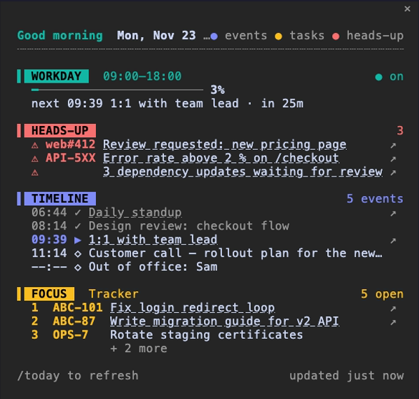

#  workday

A Today pane for Claude Code, plus a `/wrapup` command for the end of the day.



`/today` asks Claude to look through your calendar, tracker, monitoring and inbox and puts the result in a pane next to the chat: today's events, the tasks on your plate, and anything that needs you now. `/wrapup` writes a short end-of-day report from the same sources and your commits of the day: from your code hosting account (GitHub, GitLab, Bitbucket), wherever the repositories live, and from local git in the folders you worked in with Claude today, for commits not pushed yet.

It doesn't care which tools you use. The mod only says what to look for, and Claude uses whatever is connected in your session: Linear or Jira, Outlook or Google Calendar, Sentry, GitHub. If a source isn't connected, it's skipped. Neither command changes anything; they only read.

## Commands

| Command | What it does |
|---|---|
| `/today` | Gather fresh data and show the pane |
| `/today on` / `off` | Open the pane at the start of every session, or keep it closed |
| `/today show` / `hide` | Show or hide the pane for now |
| `/today hide focus` | Hide one card (`workday`, `timeline`, `focus`, `heads-up`). It stays hidden in later sessions until you `show` it |
| `/today demo` | Fill the pane with sample data so you can see every state. Good for screenshots |
| `/today demo off` | Back to your own data |
| `/today config` | Print the current settings |
| `/wrapup [note]` | End-of-day report: done, still open, first thing tomorrow, rough time blocks for time tracking |

`/today` gathers the data in a background agent, so your chat stays free and nothing waits for the turn you're in. The pane says "updating…" until the agent is done. Where the pane can't show (an IDE, a narrow terminal) or background agents are off, `/today` runs in the chat instead and lists the result there.

With `/today on`, a new session shows the last data you gathered that day. It also runs `/today` once by itself, unless that data is under 15 minutes old. This costs one Claude request per session; turn off refresh on start in the settings if you'd rather not. For updates during the day, turn on auto-refresh.

The pane greets you by the time of day: "Good morning", or "Guten Morgen" on a German system. In front of it sits the sky of the hour: 🌙 at night, 🌅 in the morning, 🌞 at noon, ⛅ in the afternoon, 🌆 in the evening.

Claude Code only opens a pane by itself in terminals at least 144 columns wide. In a narrower window, use `/today show`.

In VS Code and the desktop app, nothing happens on its own: no pane at start and no refresh on start. Run `/today` there when you want it.

## Settings

Set these in `/config`.

| Setting | Default | |
|---|---|---|
| Workday start / end | 09:00 / 18:00 | Range of the progress bar |
| Focus: tasks shown | 3 | Tasks listed before "+ N more" |
| Tasks fetched | 7 | Most tasks `/today` will gather |
| Heads-up: items shown | 5 | Items listed before "+ N more" |
| Timeline: events shown | 8 | Starts with the last event before now |
| Stale after (minutes) | 60 | When the pane flags its data as old and suggests `/today`. 0 turns it off |
| Refresh on start | on | Each start of Claude Code runs `/today` once by itself (`/clear` and reloading plugins don't), unless the data is under 15 minutes old or the pane is turned off with `/today off`. One Claude request per session |
| Auto-refresh (minutes) | 0 | 0 is off. Otherwise `/today` runs by itself every N minutes, at least 15. Only during the workday, with the pane on screen and no demo showing. Each run is one background agent: it costs a Claude request but adds nothing to the conversation |
| Preferred sources | empty | For example "Jira, Teams". Empty means whatever is connected |
| Palette | calm | `calm` (teal, indigo, amber, coral), `nordic`, `warm`, `theme` (follows your Claude Code theme) or `mono` |
| Color: Workday / Timeline / Focus / Heads-up | empty | A hex value like `#ff8800` or a theme name like `success`. Overrides the palette for that card |

Reports come out in whatever language you use with Claude.

## Requirements

Nothing is required. Whatever is missing just leaves its part of the pane or report empty:

| What | Used for | Without it |
|---|---|---|
| Connected tools (calendar, tracker, monitoring, mail) | Everything `/today` shows | That source is skipped |
| Code hosting access: a connector, or a logged-in CLI such as `gh` or `glab` | Commits and pull requests in `/wrapup`, and the `repo#number` keys on review items in `/today` | No hosted commits in the report, and review items show without a number |
| `git` | Commits in `/wrapup` that aren't pushed yet | Only pushed commits show up |

`/wrapup` also reads the session files under `~/.claude/projects` (or `$CLAUDE_CONFIG_DIR/projects`) to find the folders you worked in today.

## Install

In a Claude Code terminal session:

```
/plugin install workday --marketplace mmohrx/workday
```

From a shell:

```
claude plugin install workday --marketplace mmohrx/workday
```

In the desktop app: click + next to the prompt box, then Plugins, Add marketplace with `mmohrx/workday`, then Add plugin.

Answer `y` to add the marketplace, then pick a scope. User scope means every session.

## License

MIT
